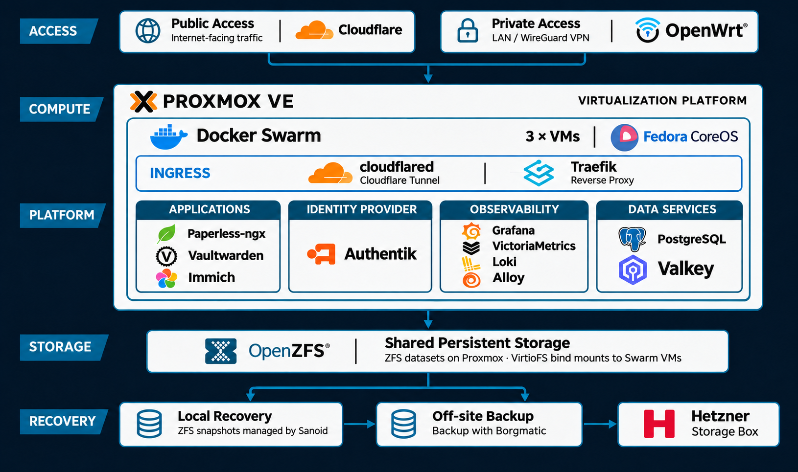

  <picture>
    <source media="(prefers-color-scheme: dark)" srcset=".github/assets/hx-lab-logo-dark.svg">
    <source media="(prefers-color-scheme: light)" srcset=".github/assets/hx-lab-logo-light.svg">
    
  </picture>

  # Homelab

  **The Self-Hosted DevSecOps Platform**

  
  
  

---

## Architecture

## Infrastructure

The homelab runs on a Minisforum A2 powered by [Proxmox VE](https://www.proxmox.com/en/proxmox-virtual-environment/overview).

[OpenTofu](https://opentofu.org/) provisions infrastructure, while [Ansible](https://docs.ansible.com/) configures the host. Network infrastructure is managed separately in [Netlab](https://github.com/Hovirix/netlab).

[Cloudflare](https://www.cloudflare.com/) provides public edge services, [Resend](https://resend.com/) delivers email through SMTP, and [Hetzner Storage Box](https://www.hetzner.com/storage/storage-box/) stores off-site backups.

## Platform

Three [Fedora CoreOS](https://fedoraproject.org/coreos/) virtual machines form a [Docker Swarm](https://docs.docker.com/engine/swarm/) cluster. The platform hosts self-hosted applications, shared data services, identity management, and observability. Services are defined declaratively as Swarm stacks.

All three VMs run on one physical host. The cluster does not provide host-level high availability.

## Storage

[OpenZFS](https://openzfs.org/) provides persistent storage, shared with Swarm nodes through [VirtioFS](https://virtio-fs.gitlab.io/). Persistent application data lives outside the VMs and survives their recreation, provided the host datasets remain intact.

[Sanoid](https://github.com/jimsalterjrs/sanoid) manages local snapshots. [borgmatic](https://torsion.org/borgmatic/) backs up Paperless, PostgreSQL, and Vaultwarden data to Hetzner Storage Box using [Borg](https://www.borgbackup.org/) over SSH. These off-site backups do not cover every persistent dataset.

## Security

Security takes priority over convenience. The approach favors minimal exposure and simple, explicit controls.

[Traefik](https://traefik.io/traefik/) routes application traffic, with public access through Cloudflare. [WireGuard](https://www.wireguard.com/) provides remote access to internal services and management interfaces. [Authentik](https://goauthentik.io/) provides application single sign-on; applications and infrastructure retain their own permission controls.

Secrets are declared through [SecretSpec](https://secretspec.dev/), stored encrypted with [SOPS](https://getsops.io/), and delivered to services as [Docker secrets](https://docs.docker.com/engine/swarm/secrets/).

The development workflow follows a [SecOps](https://www.microsoft.com/en-us/security/business/security-101/what-is-security-operations-secops) approach. CI checks workflows, infrastructure code, secrets, and container images for security issues.

## Development

Git stores the desired state, and deployments are triggered manually. Infrastructure and services are provisioned through code and Task workflows. Rebuilding still requires bootstrap access, secrets, infrastructure state, and intact data or usable backups.

## Operations

Operational workflows use [Task](https://taskfile.dev/) to orchestrate Bash and Python workers from the command line.

Run `task` to see available operations.

## Documentation

Documentation is intentionally minimal. Configuration and executable workflows are the primary reference, with project rules in [AGENTS.md](AGENTS.md).

Open an [issue](https://github.com/Hovirix/homelab/issues) for questions or discussion.

## License

Licensed under the [MIT License](LICENSE).
